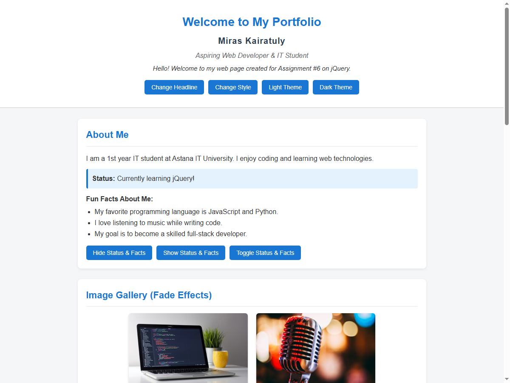
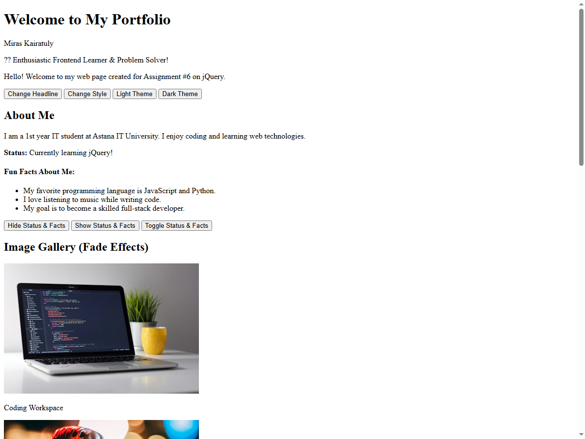
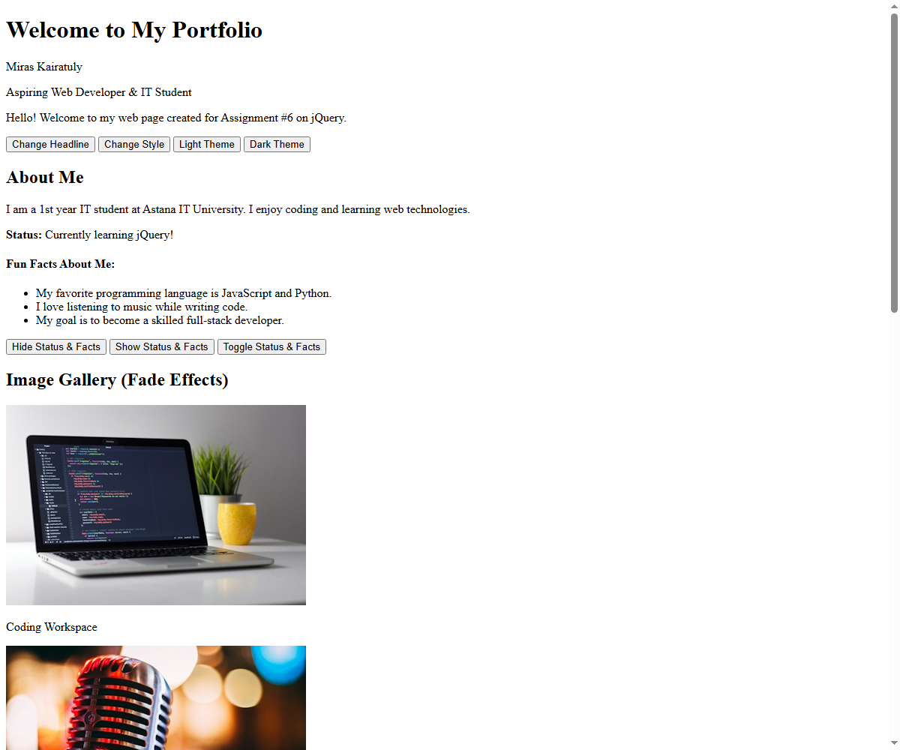

# Assignment #6: jQuery (Selectors, Effects, Animations)

**Student Name:** Miras Kairatuly  
**Group:** IT 2504  
**Subject:** WEB Technologies 1 (Front End)  
**Instructor:** Gulfiya Usserbayeva  

---

## Project Links
- **GitHub Repository:** [https://github.com/riftlik-bit/WEB_6Assignment](https://github.com/riftlik-bit/WEB_6Assignment)
- **GitHub Pages (Live):** [https://riftlik-bit.github.io/WEB_6Assignment/](https://riftlik-bit.github.io/WEB_6Assignment/)

---

## Part 1. Getting Started with jQuery

### Task 0. Setup
- Connected jQuery library using official CDN link: ``.
- Verified that the DOM is ready using standard `$(document).ready(function() { ... })`.
- Logged `"jQuery is ready!"` to the browser console.

### Task 1. Selectors & CSS
- Created a profile section with title *"Welcome to My Portfolio"*, student name, personal headline, and introduction.
- Applied jQuery selectors:
  - Tag selector: `$("h2")`
  - ID selector: `$("#student-name")`, `$("#personal-headline")`
  - Class selector: `$(".intro-text")`
- Used `.text()` to dynamically toggle the personal headline upon button click.
- Used `.css()` to dynamically modify styling (colors, font-size).
- Implemented Light and Dark themes toggled using jQuery (`$("body").addClass("dark-mode")` / `removeClass("dark-mode")`).

*Figure 1.1: Portfolio header with selectors and light theme.*

*Figure 1.2: Dark theme activated via jQuery.*

---

## Part 2. jQuery Effects

### Task 2. Visibility Methods (`.hide()`, `.show()`, `.toggle()`)
- Added an "About Me" section containing a short biography, current status (`"Currently learning jQuery!"`), and fun facts.
- Added three buttons: **Hide**, **Show**, and **Toggle** controlling visibility using jQuery's `.hide()`, `.show()`, and `.toggle()`.

### Task 3. Fade Methods (`.fadeIn()`, `.fadeOut()`, `.fadeToggle()`)
- Added an image gallery displaying hobby and coding images.
- Implemented buttons triggering `.fadeOut(600)`, `.fadeIn(600)`, and `.fadeToggle(600)` for smooth opacity transitions.

### Task 4. Slide Methods (`.slideUp()`, `.slideDown()`, `.slideToggle()`)
- Created collapsible panels for *"My Favorite Music"*, *"My Favorite Movie"*, and *"My Favorite Subject"*.
- Clicking each heading smoothly slides the panel open or closed using `.slideToggle(350)`.
- Added control buttons to slide up or down all panels simultaneously.

*Figure 2: Slide accordion panels opened using jQuery slide effects.*

---

## Part 3. DOM Manipulation with jQuery

### Task 5. Add & Remove Elements (`.append()`, `.prepend()`, `.remove()`)
- Created an initial technical skills list with 4 skills (HTML5, CSS3, JavaScript, Git & GitHub).
- Implemented an input field to enter a new skill.
- Added validation to prevent empty skills from being added (`val.trim() === ""`).
- Added buttons:
  - **Add Skill (Append):** inserts the item at the end using `.append()`.
  - **Prepend Skill:** inserts the item at the top using `.prepend()`.
  - **Remove Skill:** removes the last skill from the list using `.last().remove()`.

### Task 6. Modifying Attributes (`.attr()`)
- Added a social media link pointing to GitHub.
- Created a button that dynamically updates the `href` attribute and anchor text using `.attr()` and `.text()` to toggle between GitHub and Astana IT University website.

### Task 7. Form Interaction (`.val()`, `.text()`, input events)
- Created a contact form with inputs for Name and Email.
- Attached jQuery `.on("input", ...)` listeners that read the current input value using `.val()` and instantly render it into a live preview box below using `.text()`.

*Figure 3: Added skills and live form feedback using jQuery DOM methods.*

---

## Part 4. Animations

### Task 8. Basic Animation (`.animate()`)
- Built three visual skill level bars (HTML/CSS at 90%, JavaScript at 75%, jQuery at 85%).
- Initial state: all bars start at `0%` width.
- Added an **"Animate My Skills"** button.
- First click: uses jQuery's `.animate({ width: "..." }, 1000)` to smoothly grow each bar to its target percentage and displays the percentage text.
- Second click: smoothly animates all bars back to `0%` width, creating a toggled animation loop.

*Figure 4: Smooth skill bar animation executed using jQuery .animate().*

---

## Summary of Work Process

During this assignment, I learned and practiced core jQuery features:
1. **Setup & Selectors:** Included jQuery via CDN, verified DOM readiness using `$(document).ready()`, and practiced selecting elements using tags, IDs, and classes to manipulate text and CSS dynamically.
2. **Effects:** Explored visibility methods (`hide`, `show`, `toggle`), fading animations (`fadeIn`, `fadeOut`, `fadeToggle`), and sliding accordions (`slideUp`, `slideDown`, `slideToggle`).
3. **DOM Manipulation:** Dynamically inserted (`append`, `prepend`) and removed DOM elements with input validation, modified HTML element attributes using `.attr()`, and built interactive live form synchronization using `.val()` and `.text()`.
4. **Custom Animations:** Created responsive progress bars and animated their dimensions smoothly using jQuery's `.animate()` method.

The code is written simply and clearly according to beginner-level front-end development standards.
